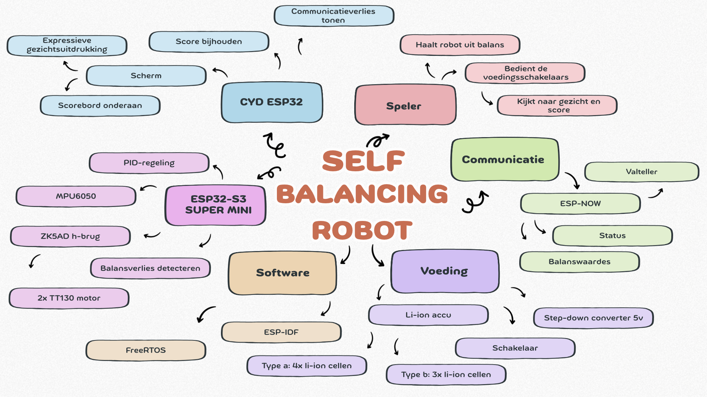

<!-- Zie [plantuml tutorial in S3](https://github.com/HU-TI-DEV/TI-S3/blob/main/software/modelleren/plantuml/README.md) voor de tutorial in S3 ove plantuml.  -->
# Ontwikkeldocument Game project: Self-Balancing Robot

Versie 1.0
Team: Yunus Kocaman en Morsal Ahmadi

## Inhoudsopgave

- [Ontwikkeldocument Zelfbalancerende Robot](#ontwikkeldocument-zelfbalancerende-robot)
  - [Inhoudsopgave](#inhoudsopgave)
  - [Inleiding](#inleiding)
  - [Overzicht](#overzicht)
  - [Leeswijzer](#leeswijzer)
  - [Uitgangspunten](#uitgangspunten)
    - [Systeemcontext](#systeemcontext)
    - [Gameplay](#gameplay)
    - [Hardware](#hardware)
  - [Requirements](#requirements)
    - [Functionele Requirements](#functionele-requirements)
    - [Niet-Functionele Requirements](#niet-functionele-requirements)
    - [Constraints](#constraints)
    - [Use Cases](#use-cases)
    - [Use Case Diagrams](#use-case-diagrams)
    - [Objectmodellen](#objectmodellen)
      - [Object beschrijvingen](#lijst-met-objecten)
    - [Klassediagrammen](#klassediagrammen)
    - [STD's](#stds)
    - [Eindresultaat](#eindresultaat)

## Inleiding

Dit ontwikkeldocument beschrijft het ontwerp en de realisatie van een
zelfbalancerende robot die als game wordt gebruikt. De robot staat op twee
wielen en houdt zichzelf rechtop met een PID-regeling. Een MPU6050 meet de
kanteling en twee TT130-motoren corrigeren die via een h-brug.

Het spel is eenvoudig uit te leggen: de speler duwt de robot. Verliest de robot
door de duw zijn balans, dan krijgt de speler een punt. De robot heeft een
gezicht op een Cheap Yellow Display (CYD). De expressie van dat gezicht hangt
af van hoe de robot balanceert, en onderaan het scherm staat de score.

De gameplay is bewust eenvoudig gehouden. De uitdaging van dit project zit
niet in de spelregels, maar in wat er nodig is om ze mogelijk te maken. Het
eerste doel is kennis opdoen over de hardware: het uitlezen en filteren van de
MPU6050, het aansturen van DC-motoren via een h-brug, het regelen van de balans
met een PID-regelaar en het opzetten van een veilige voeding met Li-ion-cellen.
Het belangrijkste doel is het toepassen van de behandelde theorie over
FreeRTOS, in combinatie met de CYD. Het meten, regelen, versturen, tekenen en
scoren moeten tegelijk en op tijd gebeuren. Dat vraagt om meerdere parallelle
taken met elk een eigen periode, deadline en prioriteit, die uitsluitend via
RTOS-synchronisatiemechanismen met elkaar communiceren.

Het systeem bestaat uit twee subsystemen die draadloos via ESP-NOW met elkaar
communiceren:

- de **ESP32-S3 Super Mini** regelt de balans, stuurt de motoren aan en stelt
  vast wanneer de robot zijn balans verliest;
- de **CYD ESP32** toont het gezicht en houdt de score bij.

De robot wordt gevoed door vier Li-ion-cellen: twee voor de elektronica
(ESP32-S3, MPU6050 en CYD) en twee voor de motoren. De software wordt geschreven met ESP-IDF, dat FreeRTOS als
besturingssysteem gebruikt.

Het doel van dit document is om het ontwerp zo vast te leggen dat de code er
direct uit afgeleid kan worden. De usecases, objectmodellen,
klassediagrammen en STD's zijn daarom onderling consistent, ook in naamgeving,
en sluiten aan op de code.

## Overzicht

### Wat de robot doet

De zelfbalancerende robot is een spel. De speler duwt de robot. Is de duw hard
genoeg om de robot zijn balans te laten verliezen, dan krijgt de speler één
punt. Na een balansverlies stoppen de motoren. De speler zet de robot weer
rechtop, waarna de robot opnieuw gaat balanceren en een volgende ronde kan
beginnen.

Op het scherm staat bovenaan een gezicht met expressieve ogen, dat laat zien
hoe het met de robot gaat. Onderaan staat de score. Door op het touchscreen te
tikken start de speler een nieuw spel: de score begint dan weer bij nul.

### Subsystemen

De robot bestaat uit twee subsystemen, elk met een eigen processor:

| **Subsysteem** | **Taak** | **Ontwikkeldocument** |
| :--- | :--- | :--- |
| **ESP32-S3 Super Mini** | Leest de MPU6050 uit, voert de PID-regeling uit, stuurt via de ZK5AD h brug de twee TT130 motoren aan en stelt vast wanneer de robot zijn balans verliest. | Ontwikkeldocument ESP32-S3 |
| **CYD ESP32** | Toont het gezicht en de score, en laat de speler via het touchscreen een nieuw spel starten. | Ontwikkeldocument CYD |

### Communicatie tussen de subsystemen

De ESP32-S3 stuurt periodiek een bericht via ESP-NOW naar de CYD. De
communicatie gaat één kant op: de CYD stuurt niets terug. Beide subsystemen
hebben een proxy-object via welke ze communiceren.

Een bericht bevat:

| **Veld** | **Betekenis** |
| :--- | :--- |
| Sessie-ID | Nieuw bij elke start van de ESP32-S3. Zo merkt de CYD dat de ESP32-S3 opnieuw is opgestart. |
| Volgnummer | Loopt op per bericht. Zo herkent de CYD verouderde of dubbele berichten. |
| Fase | Waar de robot mee bezig is (zie hieronder). |
| Balanswaarde | De actuele balanswaarde. |
| Bewegingsrichting | De richting waarin de wielen draaien. |
| Valteller | Het aantal balansverliezen sinds de start van de ESP32-S3. |

De fase heeft één van de volgende waarden:

| **Fase** | **Betekenis** |
| :--- | :--- |
| `KALIBREREN` | De ESP32-S3 initialiseert en bepaalt het nulpunt. Motoren staan stil. |
| `BALANCEREN` | De PID-regeling houdt de robot rechtop. |
| `BALANSVERLIES` | De robot is omgevallen. Motoren staan stil en de robot wacht tot hij rechtop wordt gezet. |
| `FOUT` | Er is een sensor-, initialisatie of regelingsfout. Motoren staan stil tot een herstart. |

### Voeding

De robot gebruikt 4 Li-ion-cellen, verdeeld over twee afzonderlijke accupacks
van elk 2 cellen:

| **Voeding** | **Accupack** | **Omzetting** | **Voedt** |
| :--- | :--- | :--- | :--- |
| **Logicavoeding** | 2 Li-ion-cellen | Step-down converter naar 5 V | ESP32-S3, MPU6050 en CYD |
| **Motorvoeding** | 2 Li-ion-cellen | Step-down converter naar 6 V | Vermogenszijde van de ZK5AD-h-brug (TT130-motoren) |

Iedere accupack heeft een hoofdschakelaar. Tijdens het spelen staan beide
voedingen aan. De software schakelt geen voedingen en gaat ervan uit dat beide
voedingen aan staan.

### Nog vast te leggen ontwerpwaarden (beide subsystemen)

- Het ESP-NOW-berichtformaat (datatypes van de velden).
- De ESP-NOW-verzendperiode (ESP32-S3) en de communicatietimeout (CYD).
- De laad- en beveiligingsarchitectuur van de twee accupacks.

## Leeswijzer

- **Uitgangspunten** beschrijft de systeemcontext, de gameplay en de
  hardware.
- **Requirements** bevat de functionele en niet-functionele requirements met
  MoSCoW-prioriteit, de constraints, de usecases en de activity diagrammen.
- **Ontwerp** werkt de usecases uit tot subsystemen en interfaces,
  objectmodellen, een taakstructurering met de gebruikte
  synchronisatiemechanismen, klassediagrammen en STD's. Aan het eind staan de
  ontwerpparameters en een traceerbaarheidstabel die laat zien hoe usecases,
  objecten, klassen, taken en code met elkaar samenhangen.
- **Realisatie** beschrijft de fysieke opbouw, de code, de tests en het
  eindresultaat.
- **Conclusie en Reflectie** blikt terug op het project en geeft aan wat beter
  of efficiënter had gekund.

## Uitgangspunten

### Systeem Context
De mindmap hieronder geeft de context van het systeem weer: de gebruiker, de twee subsystemen met hun sensoren en actuatoren, de communicatie en de voeding.

De relaties met de omgeving zijn:

| **Externe entiteit** | **Interactie met het systeem** |
| :--- | :--- |
| Speler | Duwt de robot, zet hem na een balansverlies rechtop, schakelt de voedingen in en uit en leest het gezicht en de score af. |
| Ondergrond | De robot balanceert en rijdt op een vlakke ondergrond; de wielen hebben grip nodig om te kunnen corrigeren. |

### Gameplay

1. De speler schakelt de robot in en houdt hem rechtop en stil, zodat de
   ESP32-S3 het nulpunt kan bepalen. Het gezicht toont een opstart- of
   wachtexpressie.
2. De robot gaat zelfstandig balanceren. Het gezicht reageert op de kanteling:
   hoe verder de robot helt, hoe sterker de expressie.
3. De speler duwt de robot. Kan de robot de duw opvangen, dan blijft hij staan
   en levert de duw niets op.
4. Is de duw zo hard dat de kantelhoek de balansverliesgrens overschrijdt, dan
   heeft de robot zijn balans verloren. De motoren stoppen, het gezicht toont
   een gevallen-expressie en de speler krijgt **één punt**.
5. De speler zet de robot weer rechtop. Zodra de robot stil genoeg staat, gaat
   hij opnieuw balanceren en kan de volgende ronde beginnen.
6. De score staat onderaan het scherm en blijft bewaard zolang de CYD aan
   staat. Als de speler het scherm aanraakt, of als de logicavoeding uit en
   weer ingeschakeld wordt, begint de score weer bij nul.

### Hardware

| **Component** | **Functie** |
| :--- | :--- |
| ESP32-S3 Super Mini | Balansregeling, motoraansturing, detectie van balansverlies, verzenden via ESP-NOW |
| MPU6050 | Meten van kanteling (accelerometer en gyroscoop); gevoed met 3,3 V vanuit de ESP32-S3 |
| ZK5AD | Dubbele h-brug voor de twee motoren |
| 2 × TT130-motor | Aandrijving van de wielen |
| CYD ESP32 | Tonen van gezicht en score, ontvangen via ESP-NOW |
| 4 Li-ion-cellen in battery shells | Twee pakketten van 2 cellen in serie (7,4 V): één voor de logicavoeding, één voor de motorvoeding |
| 2 step-down converters | 7,4 V naar 5 V voor de logicavoeding, 7,4 V naar 6 V voor de motorvoeding |
| 2 schakelaars | Afzonderlijk in- en uitschakelen van de logicavoeding en de motorvoeding |

De robot heeft twee aparte voedingen, elk met een eigen accupakket van twee
Li-ion-cellen in serie (7,4 V) en een eigen schakelaar:

- de **logicavoeding** wordt met een step-down converter omgezet naar 5 V en
  voedt de ESP32-S3 en de CYD. De ESP32-S3 voedt op zijn beurt de MPU6050 met
  3,3 V;
- de **motorvoeding** wordt met een step-down converter omgezet naar 6 V en
  voedt de vermogenszijde van de ZK5AD, die de twee TT130-motoren aanstuurt.

Beide voedingen hebben een gemeenschappelijke massa (common ground), zodat de
stuursignalen van de ESP32-S3 naar de ZK5AD hetzelfde referentiepunt hebben.
Doordat de motoren een eigen pakket hebben, veroorzaken stroompieken van de
motoren geen spanningsdips bij de ESP32-S3, de MPU6050 en de CYD.

De schakelaars zijn geen softwarematige start-, stop- of noodstopfunctie.

## Requirements

De requirements zijn afgeleid van de usecases. Iedere requirement heeft een
uniek ID, zodat in het ontwerp en de code naar de requirement verwezen kan
worden. De kolom **Bron** geeft aan uit welke usecase de requirement komt. De
prioriteit is bepaald met MoSCoW:

- **Must:** noodzakelijk; zonder deze requirement werkt de game niet of
  voldoet hij niet aan de opdracht.
- **Should:** belangrijk, maar de game is ook zonder speelbaar.
- **Could:** wenselijk als er tijd over is.
- **Would:** wordt in dit project niet gerealiseerd, maar is een mogelijke
  uitbreiding.

Getallen die zijn gemarkeerd als *(voorlopig)* zijn streefwaarden. De
definitieve waarden worden na testen vastgelegd in de
[Ontwerpparameters](#ontwerpparameters).

### Functionele Requirements
#### ESP32-S3 Super Mini

| **ID** | **Naam** | **Omschrijving** | **Rationale** | **Prioriteit** | **Bron** |
| :--- | :--- | :--- | :--- | :--- | :--- |
| FR-01 | Initialiseren | Na het inschakelen bepaalt de ESP32-S3 het nulpunt van de balansmeting zodra de robot rechtop en stil staat. Tot dat moment blijven de motoren stil. | Zonder nulpunt balanceert de robot schuin. De robot mag niet gaan rijden voordat de regeling klaar is. | Must | UC-S3-01 |
| FR-02 | Balanceren | De ESP32-S3 berekent uit de MPU6050-metingen een balanswaarde en houdt de robot met een PID-regeling rechtop. Het motorcommando blijft binnen de maximale motoruitgang. | Dit is de kernfunctie van de robot: zonder balansregeling is er geen spel. | Must | UC-S3-02 |
| FR-03 | Balansverlies detecteren | Ligt de balanswaarde langer dan de bevestigingstijd buiten de balansverliesgrens, dan stelt de ESP32-S3 een balansverlies vast en stopt hij de motoren. | Een balansverlies levert de speler een punt op. Een omgevallen robot met draaiende wielen is onveilig. | Must | UC-S3-03 |
| FR-04 | Valteller bijhouden | De ESP32-S3 verhoogt bij ieder balansverlies een valteller met precies één. | De valteller is de bron van de score. | Must | UC-S3-03 |
| FR-05 | Hervatten na balansverlies | Zet de speler de robot rechtop, dan gaat de robot weer balanceren zodra hij binnen de herstartgrens en stil genoeg staat. | Zonder deze functie zou de robot na iedere val opnieuw opgestart moeten worden. | Must | UC-S3-03 |
| FR-06 | Balansgegevens versturen | De ESP32-S3 verstuurt periodiek via ESP-NOW de balanswaarde, bewegingsrichting, status en valteller naar de CYD. | De CYD heeft deze gegevens nodig voor het gezicht en de score. | Must | UC-S3-04 |
| FR-07 | Fouttoestand afhandelen | Bij een sensor-, initialisatie- of regelingsfout zet de ESP32-S3 de motoren stil totdat hij opnieuw wordt opgestart. | Met onbetrouwbare meetdata kan de robot niet veilig geregeld worden. | Must | UC-S3-05 |

#### CYD ESP32

| **ID** | **Naam** | **Omschrijving** | **Rationale** | **Prioriteit** | **Bron** |
| :--- | :--- | :--- | :--- | :--- | :--- |
| FR-08 | Gezichtsexpressie tonen | De CYD toont een gezicht met expressieve ogen. De expressie hangt af van de status en de balansafwijking in het laatst ontvangen geldige bericht. | Het gezicht geeft de robot karakter en laat zien hoe de robot ervoor staat. | Must | UC-CYD-01 |
| FR-09 | Score bijhouden | De CYD geeft de speler één punt per balansverlies, op basis van de ontvangen valteller. | Dit is de spelregel van de game. | Must | UC-CYD-02 |
| FR-10 | Score tonen | De CYD toont de score onderaan het scherm, onder het gezicht. | De opdracht vraagt om een lokaal scoreboard op het display. | Must | UC-CYD-02 |
| FR-11 | Communicatieverlies tonen | Ontvangt de CYD binnen de communicatietimeout geen geldig bericht, dan toont hij dat de gegevens niet actueel zijn. | De speler moet kunnen zien dat het gezicht niet meer klopt. | Should | UC-CYD-03 |

### Niet-Functionele Requirements

| **ID** | **Naam** | **Omschrijving** | **Rationale** | **Prioriteit** |
| :--- | :--- | :--- | :--- | :--- |
| NFR-01 | Regelfrequentie | De balansregeling draait minimaal op 100 Hz *(voorlopig)*. | Bij een lagere frequentie valt de robot om voordat de correctie effect heeft. | Must |
| NFR-02 | Onafhankelijke regeling | Een storing in ESP-NOW of de CYD heeft geen invloed op de balansregeling. | De robot moet blijven balanceren, ook als de verbinding met de CYD wegvalt. | Must |
| NFR-03 | Veilige motorstand | Buiten de status `BALANCEREN` zijn de motorcommando's altijd nul. | De robot mag niet rijden tijdens kalibreren, na een val of bij een fout. | Must |
| NFR-04 | Balanceerduur | Zonder verstoring blijft de robot minimaal 60 seconden rechtop staan *(voorlopig)*. | Valt de robot vanzelf om, dan krijgt de speler een punt zonder te duwen. | Must |
| NFR-05 | Lichte duw opvangen | Een lichte duw leidt niet tot een balansverlies. | Alleen een harde duw mag een punt opleveren. | Should |
| NFR-06 | Reactietijd display | Een verandering in status of balans is binnen 200 ms zichtbaar op het scherm *(voorlopig)*. | Anders lijkt het gezicht niet bij de robot te horen. | Should |

### Constraints

| **ID** | **Constraint** | **Toelichting** |
| :--- | :--- | :--- |
| C-01 | De balansregeling draait op een ESP32-S3 Super Mini. | Gegeven hardware. |
| C-02 | Het gezicht en de score worden getoond op een CYD (Cheap Yellow Display) met ESP32. | Gegeven hardware. |
| C-03 | De kanteling wordt gemeten met een MPU6050. | Gegeven hardware. |
| C-04 | De motoren worden aangestuurd via een ZK5AD dubbele h brug. | Gegeven hardware. |
| C-05 | De aandrijving bestaat uit twee TT130-DC-motoren (3–6 V). | Gegeven hardware. |
| C-06 | De voeding bestaat uit twee pakketten van 2 Li-ion-cellen in serie (7,4 V), met een gemeenschappelijke massa. De logicavoeding gaat via een step-down converter naar 5 V voor de ESP32-S3 en de CYD; de motorvoeding gaat via een step-down converter naar 6 V voor de ZK5AD. | Gekozen hardware. |
| C-07 | De ESP32-S3 en de CYD communiceren via ESP-NOW. | Beide subsystemen zijn ESP32's; ESP-NOW werkt zonder router of access point. |
| C-08 | De firmware wordt ontwikkeld met ESP-IDF en draait op FreeRTOS. | Opdracht: de game is gebaseerd op een real-time operating system. |
| C-09 | Iedere firmware bestaat uit meerdere parallelle taken die uitsluitend via RTOS-synchronisatiemechanismen met elkaar communiceren. | Opdracht (rubric Operating Systems). |
| C-10 | De code volgt de code-richtlijnen, inclusief Doxygen-commentaar. | Opdracht (rubric Code richtlijnen). |
| C-11 | De code is in volledige overeenstemming met de klassediagrammen en STD's, ook qua naamgeving. | Opdracht (rubric Structured programming II). |
| C-12 | Usecases, objectmodellen, klassediagrammen en STD's worden volgens de richtlijnen van HU-ICT-TI gemaakt en zijn onderling consistent. | Opdracht (rubric Structured programming I). |
| C-13 | Er wordt lokaal een scoreboard bijgehouden en op het display getoond. | Opdracht (rubric Functioneel III). |
| C-14 | Op te leveren: een zip met alle code, een PDF van dit ontwikkeldocument met alle diagrammen, en een rechtenvrije PR-film van maximaal 60 seconden waarin de gameplay te zien is. | Opdracht. |

### Use Cases
Zie [UC-folder](https://github.com/morsal6/Self-Balancing-Robot/blob/main/docs/03-use-cases/AllUseCasesV2(laatste-versie).md)
# Usecase beschrijvingen 

## ESP32-S3 Super Mini

Zie het overzichtsdocument voor de werking van de hele robot, de voeding en de
inhoud van de ESP-NOW-berichten.

| **[UC-S3-00] Robot besturen** | |
| :--- | :--- |
| **Actor** | Gebruiker |
| **Beschrijving** | Bepaalt wanneer de robot initialiseert, balanceert en een balansverlies afhandelt, en wat er gebeurt bij een fout. Houdt UC-S3-04 op de hoogte van de fase waarin de robot zich bevindt. UC-S3-04 Versturen draait parallel aan deze use case. |
| **Scenario** | 1. Aan UC-S3-04 wordt doorgegeven dat de robot in de fase `KALIBREREN` is. 2. Voer UC-S3-01 Initialiseren uit. 3. Aan UC-S3-04 wordt doorgegeven dat de robot in de fase `BALANCEREN` is. 4. Voer UC-S3-02 Balanceren uit. 5. Aan UC-S3-04 wordt doorgegeven dat de robot in de fase `BALANSVERLIES` is. 6. Voer UC-S3-03 Balansverlies afhandelen uit. 7. Goto 3. |
| **Uitzonderingen** | - **UC-S3-01, UC-S3-02 of UC-S3-03 stelt een fout vast:** aan UC-S3-04 wordt doorgegeven dat de robot in de fase `FOUT` is, en UC-S3-05 Fouttoestand afhandelen wordt uitgevoerd. |

| **[UC-S3-01] Initialiseren** | |
| :--- | :--- |
| **Actor** | Gebruiker, MPU6050, ZK5AD |
| **Beschrijving** | Maakt de sensor, de motoruitgangen, de ESP-NOW verbinding en de balansregeling gereed, en bepaalt het nulpunt van de balansmeting terwijl de gebruiker de robot rechtop en stil houdt. |
| **Pre-condities** | UC-S3-00 voert deze use case uit, direct na het opstarten van de ESP32-S3. De gebruiker houdt de robot rechtop en stil. |
| **Scenario** | 1. Er wordt een nieuw sessie-ID gegenereerd en de valteller wordt op nul gezet. 2. De motoruitgangen worden geïnitialiseerd met een nulcommando. 3. De communicatie met de MPU6050 wordt gestart. 4. De ESP-NOW-verbinding met de CYD wordt geconfigureerd. 5. Wacht op een nieuwe meting van de MPU6050. 6. Is de meting ongeldig, zie de uitzondering *De MPU6050 levert een ongeldige meting*. 7. Beweegt de robot, dan begint de kalibratietijd opnieuw: goto 5. 8. Staat de robot nog niet gedurende de kalibratietijd stil: goto 5. 9. Het nulpunt van de balansmeting wordt bepaald. 10. De PID-regeling wordt geïnitialiseerd met de ingestelde parameters. |
| **Invariant** | Zolang de initialisatie niet is voltooid, blijven de motorcommando's nul. |
| **Post-condities** | De ESP32-S3 beschikt over een geldig nulpunt, een sessie-ID en een valteller van nul. Terug naar UC-S3-00. |
| **Uitzonderingen** | - **De MPU6050 reageert niet of levert een ongeldige meting:** de motorcommando's blijven nul en er wordt een sensorfout aan UC-S3-00 gemeld. - **De motoruitgangen kunnen niet veilig worden geïnitialiseerd:** de motorcommando's blijven nul en er wordt een initialisatiefout aan UC-S3-00 gemeld. - **ESP-NOW kan niet worden geconfigureerd:** de initialisatie gaat door; de robot kan balanceren zonder de CYD. |

| **[UC-S3-02] Balanceren** | |
| :--- | :--- |
| **Actor** | MPU6050, ZK5AD, TT130-motoren |
| **Beschrijving** | Verwerkt iedere meting tot een balanswaarde. De PID-regeling gebruikt de afwijking ten opzichte van het nulpunt om de linker- en rechtermotor aan te sturen en de robot rechtop te houden, totdat de robot zijn balans verliest. |
| **Pre-condities** | UC-S3-00 voert deze use case uit, na een geslaagde initialisatie (UC-S3-01) of nadat de robot weer rechtop is gezet (UC-S3-03). |
| **Scenario** | 1. Wacht op een nieuwe meting van de MPU6050. De MPU6050 levert iedere regelperiode een meting. 2. De accelerometer- en gyroscoopmetingen worden gefilterd en gecombineerd tot een balanswaarde. 3. Ligt de balanswaarde buiten de balansverliesgrens: goto 9. 4. De afwijking ten opzichte van het nulpunt wordt bepaald. 5. De proportionele, integrale en differentiële PID-componenten worden berekend en gecombineerd tot een correctiecommando, dat wordt begrensd tot het toegestane bereik. 6. De richting en snelheid van de linker en rechtermotor worden bepaald, en de ZK5AD stuurt de TT130-motoren aan. 7. De actuele balanswaarde en bewegingsrichting worden aan UC-S3-04 doorgegeven. 8. Goto 1. 9. Er wordt geen correctie toegepast. 10. Ligt de balanswaarde nog niet gedurende de bevestigingstijd onafgebroken buiten de balansverliesgrens: goto 1. 11. Er is een balansverlies vastgesteld. |
| **Invariant** | De PID-uitgang en de motorcommando's blijven binnen de ingestelde veiligheidsgrenzen. |
| **Post-condities** | Er is een balansverlies vastgesteld. Terug naar UC-S3-00. |
| **Uitzonderingen** | - **Een sensorwaarde is ongeldig:** er wordt geen nieuwe correctie toegepast, beide motorcommando's worden op nul gezet en er wordt een sensorfout aan UC-S3-00 gemeld. |

| **[UC-S3-03] Balansverlies afhandelen** | |
| :--- | :--- |
| **Actor** | Gebruiker, MPU6050, ZK5AD, TT130-motoren |
| **Beschrijving** | Na een balansverlies worden de motoren gestopt en wordt de valteller met één verhoogd. Daarna wacht de robot tot de gebruiker hem weer rechtop zet. De herstartgrens ligt ruim binnen de balansverliesgrens, zodat een wiebelende robot niet te vroeg herstart. |
| **Pre-condities** | UC-S3-00 voert deze use case uit, nadat UC-S3-02 een balansverlies heeft vastgesteld. |
| **Scenario** | 1. Beide motorcommando's worden op nul gezet. 2. De integrale component van de PID-regeling wordt gereset. 3. De valteller wordt met één verhoogd en aan UC-S3-04 doorgegeven. 4. Wacht op een nieuwe meting van de MPU6050, terwijl de gebruiker de robot rechtop zet. 5. De metingen worden gefilterd en gecombineerd tot een balanswaarde. 6. Ligt de balanswaarde buiten de herstartgrens of beweegt de robot, dan begint de hersteltijd opnieuw: goto 4. 7. Staat de robot nog niet gedurende de hersteltijd rechtop en stil: goto 4. 8. De PID-regeling wordt opnieuw geïnitialiseerd. |
| **Invariant** | Een balansverlies verhoogt de valteller precies een keer. Zolang deze use case loopt, blijven de motorcommando's nul. |
| **Post-condities** | De robot staat rechtop en stil, en de PID-regeling is opnieuw geïnitialiseerd. Terug naar UC-S3-00. |
| **Uitzonderingen** | - **Een sensorwaarde is ongeldig:** er wordt een sensorfout aan UC-S3-00 gemeld. |

| **[UC-S3-04] Versturen** | |
| :--- | :--- |
| **Actor** | CYD ESP32 (via ESP-NOW) |
| **Beschrijving** | Stuurt periodiek de actuele gegevens via ESP-NOW naar de CYD, zodat die het gezicht en de score kan tonen. Draait parallel aan UC-S3-00. |
| **Scenario** | 1. Wacht tot de verzendperiode verstreken is, of tot er een nieuwe fase of valteller is doorgegeven. 2. De actuele balanswaarde, bewegingsrichting, fase en valteller worden gelezen. 3. Deze gegevens worden samen met het sessie-ID en een opgehoogd volgnummer in een bericht geplaatst. 4. Het bericht wordt via ESP-NOW naar de CYD verzonden. 5. Goto 1. |
| **Invariant** | Een storing in ESP-NOW blokkeert de balansregeling en de motorsturing niet. |
| **Uitzonderingen** | - **De CYD is niet bereikbaar of het bericht kan niet worden verzonden:** het bericht vervalt; bij de volgende verzendperiode wordt een nieuw bericht verstuurd. - **Een bericht met een balansverlies gaat verloren:** het volgende bericht bevat de bijgewerkte valteller, zodat de CYD het gemiste balansverlies alsnog kan tellen. |

| **[UC-S3-05] Fouttoestand afhandelen** | |
| :--- | :--- |
| **Actor** | ZK5AD |
| **Beschrijving** | Wanneer sensorwaarden, regelberekeningen of motoruitgangen niet betrouwbaar zijn, worden de motoren veilig stilgezet. Een fouttoestand is iets anders dan een balansverlies: een balansverlies hoort bij het spel, een fout niet. |
| **Pre-condities** | UC-S3-00 voert deze use case uit, nadat UC-S3-01, UC-S3-02 of UC-S3-03 een fout heeft gemeld. |
| **Scenario** | 1. Beide motorcommando's worden op nul gezet. 2. De balansinformatie wordt als ongeldig gemarkeerd, zodat UC-S3-04 geen ongeldige balanswaarde verstuurt. 3. Wacht tot de ESP32-S3 opnieuw wordt opgestart (met de resetknop). |
| **Invariant** | Ongeldige meetdata wordt nooit als geldige balanswaarde gebruikt. Een fout verhoogt de valteller niet. |

### Relaties tussen de usecases

- UC-S3-00 `include` UC-S3-01, UC-S3-02 en UC-S3-03 (UC-S3-00 voert ze na elkaar uit).
- UC-S3-05 `extend` UC-S3-00 wanneer een uitgevoerde use case een fout meldt.
- UC-S3-04 draait parallel aan UC-S3-00 en heeft geen relatie met de andere use cases: de gegevens worden alleen doorgegeven.

### Nog vast te leggen ontwerpwaarden

- De MPU6050 balans as.
- De PID-parameters en de maximale motorpower.
- De regelperiode.
- De kalibratietijd (hoe lang de robot stil moet staan tijdens het initialiseren).
- De balansverliesgrens en de bevestigingstijd.
- De herstartgrens en de hersteltijd na een balansverlies.
- Wanneer de robot "beweegt" (grens voor de gyroscoopmeting).

## CYD ESP32

| **[UC-CYD-01] Tonen** | |
| :--- | :--- |
| **Actor** | ESP32-S3 (via ESP-NOW), Gebruiker |
| **Beschrijving** | De CYD ontvangt berichten van de ESP32-S3 en vertaalt de fase, de balansafwijking en de bewegingsrichting naar een gezicht met expressieve ogen. |
| **Pre-condities** | — |
| **Scenario** | 1. Het scherm en de ESP-NOW-ontvanger worden geïnitialiseerd. 2. Wacht op een ESP-NOW-bericht. 3. Het formaat en het volgnummer van het bericht worden gecontroleerd. 4. De fase, balansafwijking en bewegingsrichting worden gelezen. 5. Een gezichtsexpressie wordt gekozen: &nbsp;&nbsp;- `KALIBREREN`: opstart of wachtexpressie; &nbsp;&nbsp;- `BALANCEREN`: expressie die past bij de balansafwijking en bewegingsrichting; &nbsp;&nbsp;- `BALANSVERLIES`: gevallen-expressie; &nbsp;&nbsp;- `FOUT`: foutexpressie. 6. De positie, richting of vorm van de ogen wordt aangepast. 7. Het gezicht wordt in het bovenste deel van het scherm getekend. 8. De valteller en het sessie-ID worden doorgegeven aan UC-CYD-02. 9. Goto 2. |
| **Uitzonderingen** | - **Het bericht is ongeldig of verouderd:** het bericht wordt genegeerd en het getoonde gezicht blijft staan: goto 2. - **De balanswaarde valt buiten het expressiebereik:** de waarde wordt begrensd tot de beschikbare gezichtstoestanden. - **Er is binnen de communicatietimeout geen geldig bericht ontvangen:** voer UC-CYD-03 Communicatieverlies tonen uit en wacht tot die klaar is, daarna goto 2. |

| **[UC-CYD-02] Score bijhouden** | |
| :--- | :--- |
| **Actor** | Gebruiker |
| **Beschrijving** | De CYD houdt per spel het aantal punten bij. Iedere keer dat de robot zijn balans verliest, krijgt de speler een punt. De CYD gebruikt hiervoor de valteller van de ESP32-S3, zodat een gemist bericht geen punt kost en een herhaald bericht geen extra punt oplevert. Door op het touchscreen te tikken start de gebruiker een nieuw spel. Deze use case draait parallel aan UC-CYD-01. |
| **Scenario** | 1. De score wordt op nul gezet en onderaan het scherm getoond. 2. Wacht tot UC-CYD-01 een valteller en sessie-ID doorgeeft, of tot de gebruiker op het touchscreen tikt. 3. Heeft de gebruiker op het touchscreen getikt, dan begint er een nieuw spel: de laatst ontvangen valteller wordt de referentie-valteller. Goto 1. 4. Is er nog geen referentie (de eerste gegevens na het opstarten van de CYD): de valteller en het sessie-ID worden als referentie opgeslagen. Goto 2. 5. Is het sessie-ID anders dan de referentie (de ESP32-S3 is opnieuw opgestart): de score wordt verhoogd met de nieuwe valteller, en het nieuwe sessie-ID en de nieuwe valteller worden de referentie. Goto 7. 6. De score wordt verhoogd met het verschil tussen de nieuwe valteller en de referentie-valteller, en de nieuwe valteller wordt de referentie-valteller. 7. De score wordt onderaan het scherm getoond. 8. Goto 2. |
| **Invariant** | Tijdens een spel kan de score alleen gelijk blijven of toenemen. Ieder balansverlies levert precies een punt op. |
| **Uitzonderingen** | - **Er zijn berichten gemist:** het verschil in valteller is groter dan een, en alle gemiste balansverliezen worden alsnog geteld. - **De maximale score is bereikt:** de score blijft op de maximale waarde staan. |

| **[UC-CYD-03] Communicatieverlies tonen** | |
| :--- | :--- |
| **Actor** | Gebruiker |
| **Beschrijving** | Maakt op het scherm zichtbaar dat de getoonde informatie niet meer actueel is, omdat er geen geldige berichten meer binnenkomen. |
| **Pre-condities** | UC-CYD-01 voert deze use case uit, omdat er binnen de communicatietimeout geen geldig bericht is ontvangen. |
| **Scenario** | 1. De laatst bekende balansinformatie wordt als niet-actueel gemarkeerd. 2. In het bovenste deel van het scherm wordt een communicatieverlies expressie getoond. De score onderaan blijft zichtbaar. |
| **Invariant** | Oude balansdata wordt nooit zonder waarschuwing als actuele data getoond. |
| **Post-condities** | De communicatieverlies expressie blijft zichtbaar totdat UC-CYD-01 weer een geldig bericht ontvangt. Terug naar UC-CYD-01. |

### Relaties tussen de usecases

- UC-CYD-03 `extend` UC-CYD-01 wanneer de communicatietimeout verstrijkt (UC-CYD-01 voert UC-CYD-03 uit en wacht tot die klaar is).
- UC-CYD-01 en UC-CYD-02 draaien parallel en hebben geen relatie: UC-CYD-01 geeft alleen de valteller en het sessie-ID door.

### Nog vast te leggen ontwerpwaarden

- De communicatietimeout.
- De maximumscore.
- De koppeling tussen fase, balanswaarde en gezichtsexpressie.
- De aansluiting en uitlezing van het touchscreen (XPT2046).

### Use Case Diagrams

Zie [UC-diagram folder](https://github.com/morsal6/Self-Balancing-Robot/tree/main/docs/02-modelling/use-case-diagrams/v2%20(na%20feedback))
/usecasediagramCYD.png>)
/usecasediagramS3.png>)

# Objectmodellen

Zie [Objectmodellen](https://github.com/morsal6/Self-Balancing-Robot/tree/main/docs/02-modelling/object-model/v2(laatste%20versie))

/ESP32 CYD/objectmodelCYD.png>)

/ESP32-S3 super mini/objectmodelS3.png>)

#### Lijst met Objecten
Zie [Objectmodellenlijst](https://github.com/morsal6/Self-Balancing-Robot/tree/main/docs/02-modelling/object-model/v2(laatste%20versie))
# Object beschrijving: object model CYD ESP32
## CYD
| Objectnaam | Stereotype | Beschrijving |
| :--- | :--- | :--- |
| TonenControl | control | "Dirigent" van use case UC-CYD-01 Tonen (zie use case beschrijving). Initialiseert scherm en ontvanger, controleert ontvangen berichten, kiest de gezichtsexpressie en geeft de valteller door aan ScoreControl. Voert CommVerliesControl uit als er te lang geen geldig bericht komt. |
| ScoreControl | control | "Dirigent" van use case UC-CYD-02 Score bijhouden (zie use case beschrijving). Draait parallel aan TonenControl. Bewaart de score, het referentie-sessie-ID en de referentie-valteller, en start een nieuw spel als het touchscreen wordt aangeraakt. |
| CommVerliesControl | control | "Dirigent" van use case UC-CYD-03 Communicatieverlies tonen (zie use case beschrijving). Wordt uitgevoerd door TonenControl. Markeert de robotdata als verouderd en toont de communicatieverlies-expressie. |
| EspNowOntvanger | boundary | Proxy van de ESP32-S3: ontvangt via ESP-NOW de berichten en meldt elk ontvangen bericht. |
| Display | boundary | Stuurt het scherm van de CYD aan: het gezicht bovenin en de score onderaan. Gebruikt hiervoor de Ili9341Display driver met backbuffer. |
| Touchscreen | boundary | Leest het touchscreen (XPT2046) uit en meldt wanneer het wordt aangeraakt. |
| RobotData | entity | Bevat de gegevens uit het laatst ontvangen geldige bericht (fase, balansafwijking, bewegingsrichting en volgnummer) en of deze nog actueel zijn. |

## ESP32s3
# Object beschrijving: object model ESP32-S3 Super Mini

| Objectnaam | Stereotype | Beschrijving |
| :--- | :--- | :--- |
| RobotControl | control | "Dirigent" van use case UC-S3-00 Robot besturen (zie use case beschrijving). Voert na elkaar Initialiseren, Balanceren en Balansverlies afhandelen uit, voert bij een fout Fouttoestand afhandelen uit, en geeft iedere nieuwe fase door. Ontvangt de metingen van de Mpu6050 en geeft ze door aan de control die op dat moment wordt uitgevoerd. |
| InitControl | control | "Dirigent" van use case UC-S3-01 Initialiseren (zie use case beschrijving). Wordt uitgevoerd door RobotControl. Maakt sensor, motoruitgangen en ESP-NOW gereed en bepaalt het nulpunt zodra de robot lang genoeg stilstaat. |
| BalansControl | control | "Dirigent" van use case UC-S3-02 Balanceren (zie use case beschrijving). Wordt uitgevoerd door RobotControl. Verwerkt iedere meting tot een correctie voor de motoren en stelt een balansverlies vast. |
| BalansverliesControl | control | "Dirigent" van use case UC-S3-03 Balansverlies afhandelen (zie use case beschrijving). Wordt uitgevoerd door RobotControl. Stopt de motoren, verhoogt de valteller en wacht tot de robot weer rechtop en stil staat. |
| FoutControl | control | "Dirigent" van use case UC-S3-05 Fouttoestand afhandelen (zie use case beschrijving). Wordt uitgevoerd door RobotControl. Zet de motoren veilig op nul en markeert de balansinformatie als ongeldig. |
| VerstuurControl | control | "Dirigent" van use case UC-S3-04 Versturen (zie use case beschrijving). Draait parallel aan RobotControl en verstuurt periodiek, of bij een nieuwe fase of valteller, een bericht naar de CYD. |
| Mpu6050 | boundary | Stuurt de MPU6050-hardware aan en meldt iedere regelperiode een nieuwe accelerometer en gyroscoopmeting. |
| MotorDriver | boundary | Stuurt via de ZK5AD h brug de linker en rechter TT130-motor aan (richting en snelheid). |
| EspNowZender | boundary | Proxy naar de CYD ESP32: configureert de ESP-NOW-verbinding en verstuurt berichten. |
| RobotFase | entity | Bevat de fase waarin de robot zich bevindt: KALIBREREN, BALANCEREN, BALANSVERLIES of FOUT. |
| Sessie | entity | Bevat het sessie-ID en de valteller. Deze data wordt als pakket naar de CYD verstuurd. |
| BalansData | entity | Bevat de actuele balanswaarde, de bewegingsrichting en of deze gegevens geldig zijn. |
| BalansFilter | — | Combineert accelerometer en gyroscoopmetingen tot een balanswaarde en bewaart het nulpunt. |
| PidRegelaar | — | erekent met de PID-parameters een begrensd motorcommando uit de afwijking ten opzichte van de doelhoek. De doelhoek volgt uit de geschatte rijsnelheid, zodat de robot niet langzaam wegrijdt. |

# Klassediagrammen
Zie [klassendiagram](https://github.com/morsal6/Self-Balancing-Robot/tree/main/docs/02-modelling/class-diagrams/v5(Laatste-versie))
## CYD

/klassediagrammen_robot_v5-Klassediagram CYD ESP32.drawio.png>)

## esp s3 mini
/klassediagrammen_robot_v5-Klassediagram ESP32-S3 Super Mini.drawio.png>)

# STD's

## CYD
Zie [STD-CYD](https://github.com/morsal6/Self-Balancing-Robot/tree/main/docs/02-modelling/state-transition-diagrams/ESP32%20CYD)

## esp s3 mini
Zie [STD-esp32s3](https://github.com/morsal6/Self-Balancing-Robot/tree/main/docs/02-modelling/state-transition-diagrams/ESP32-S3%20Super%20Mini)
.drawio.png>)
.drawio.png>)
.drawio.png>)

### Eindresultaat

### Wat nog niet goed werkt

Als de motoren hard optrekken of plotseling stoppen, herstart de ESP32-S3 soms.
Ik vermoed dat de oorzaak is dat er een storing van de motoren op de voeding en de massa plaatsvind, ook al hebben de motoren een
eigen accupack. De CYD toont dan het gezicht voor verbindingsverlies, totdat de
ESP32-S3 weer opgestart is. Een elco van 1000 µF op de motorvoeding van de
h-brug maakte het minder, maar loste het niet op.

### Wat we beter zouden doen

- Encoders op de wielen. Nu schatten we de snelheid uit het motorcommando. Met
  echte snelheidsmeting kan de robot beter op zijn plek blijven.
- Vanaf het begin rekening houden met storing van de motoren, met
  condensatoren en een goede massa.
- Bij het opstarten eerst ESP-NOW starten en daarna pas het eerste bericht
  sturen. Nu gaat het allereerste bericht verloren.

### Wat goed ging

- De robot balanceert zelfstandig. Na een val stoppen de motoren en balanceert
  hij weer zodra hij rechtop en stil staat.
- De score klopt ook als er berichten gemist worden of als de ESP32-S3
  opnieuw opstart, doordat de CYD met de valteller en het sessie-ID rekent.
- Het gezicht reageert op de kanteling en laat zien wanneer de robot valt, een
  fout heeft of geen verbinding meer heeft.
- Beide ESP32's werken met meerdere taken die alleen via queues, event groups,
  timers en mutexen met elkaar praten. Daardoor loopt de regeling door, ook als
  de verbinding met de CYD wegvalt.
- De code volgt de klassediagrammen en STD's. Elke toestand en elke overgang
  uit de STD's is terug te vinden in de code.