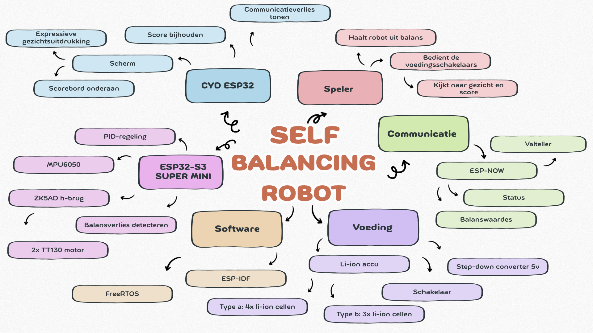

<!-- Zie [plantuml tutorial in S3](https://github.com/HU-TI-DEV/TI-S3/blob/main/software/modelleren/plantuml/README.md) voor de tutorial in S3 ove plantuml.  -->
# Ontwikkeldocument Game project: Self-Balancing Robot

Versie 1.0
Team: Yunus Kocaman en Morsal Ahmadi

## Inhoudsopgave

- [Ontwikkeldocument Zelfbalancerende Robot](#ontwikkeldocument-zelfbalancerende-robot)
  - [Inhoudsopgave](#inhoudsopgave)
  - [Inleiding](#inleiding)
  - [Leeswijzer](#leeswijzer)
  - [Uitgangspunten](#uitgangspunten)
    - [Systeemcontext](#systeemcontext)
    - [Gameplay](#gameplay)
    - [Hardwarevarianten](#hardwarevarianten)
  - [Requirements](#requirements)
    - [Functionele Requirements](#functionele-requirements)
    - [Niet-Functionele Requirements](#niet-functionele-requirements)
    - [Constraints](#constraints)
    - [Use Cases](#use-cases)
    - [Activity Diagrammen](#activity-diagrammen)
  - [Ontwerp](#ontwerp)
    - [Subsystemen en interfaces](#subsystemen-en-interfaces)
    - [Objectmodellen](#objectmodellen)
      - [Lijst met Objecten](#lijst-met-objecten)
    - [Taakstructurering](#taakstructurering)
      - [Taaksoort en deadline](#taaksoort-en-deadline)
      - [Taken samenvoegen](#taken-samenvoegen)
      - [Synchronisatiemechanismen](#synchronisatiemechanismen)
    - [Klassediagrammen](#klassediagrammen)
    - [STD's](#stds)
    - [Ontwerpparameters](#ontwerpparameters)
    - [Traceerbaarheid](#traceerbaarheid)
  - [Realisatie](#realisatie)
    - [Fysieke View](#fysieke-view)
    - [Code](#code)
    - [Testen](#testen)
    - [Eindresultaat](#eindresultaat)
  - [Conclusie en Reflectie](#conclusie-en-reflectie)
  - [Appendices](#appendices)
    - [Appendix 1: Afstemming gameplay met docent](#appendix-1-afstemming-gameplay-met-docent)
    - [Appendix 2: Referenties](#appendix-2-referenties)

## Inleiding
Dit ontwikkeldocument beschrijft het ontwerp en de realisatie van een zelfbalancerende robot die als game wordt gebruikt. De robot staat op twee wielen en houdt zichzelf rechtop met een PID-regeling. Een MPU6050 meet de kanteling en twee TT130-motoren corrigeren die via een h-brug.

Het spel is eenvoudig uit te leggen: de speler duwt de robot. Verliest de robot door de duw zijn balans, dan krijgt de speler een punt. De robot heeft een gezicht op een Cheap Yellow Display (CYD). De expressie van dat gezicht hangt af van hoe de robot balanceert, en onderaan het scherm staat de score.

De gameplay is bewust eenvoudig gehouden. De uitdaging van dit project zit niet in de spelregels, maar in wat er nodig is om ze mogelijk te maken. Het eerste doel is kennis opdoen over de hardware: het uitlezen en filteren van de MPU6050, het aansturen van DC-motoren via een h-brug, het regelen van de balans met een PID-regelaar en het opzetten van een veilige voeding met Li-ion-cellen. Het belangrijkste doel is het toepassen van de behandelde theorie over FreeRTOS, in combinatie met de CYD. Het meten, regelen, versturen, tekenen en scoren moeten tegelijk en op tijd gebeuren. Dat vraagt om meerdere parallelle taken met elk een eigen periode, deadline en prioriteit, die uitsluitend via RTOS-synchronisatiemechanismen met elkaar communiceren.

Het systeem bestaat uit twee subsystemen die draadloos via ESP-NOW met elkaar communiceren:

de ESP32-S3 Super Mini regelt de balans, stuurt de motoren aan en stelt vast wanneer de robot zijn balans verliest;
de CYD ESP32 toont het gezicht en houdt de score bij.

De robot is in twee hardwarevarianten gebouwd, die alleen verschillen in het aantal accucellen. De software is voor beide varianten gelijk en wordt geschreven met ESP-IDF, dat FreeRTOS als besturingssysteem gebruikt.

Het doel van dit document is om het ontwerp zo vast te leggen dat de code er direct uit afgeleid kan worden. De usecases, objectmodellen, taakstructurering, klassediagrammen en STD's zijn daarom onderling consistent, ook in naamgeving, en sluiten aan op de code.

## Leeswijzer
- Uitgangspunten beschrijft de systeemcontext, de gameplay en de twee hardwarevarianten.
- Requirements bevat de functionele en niet-functionele requirements met MoSCoW-prioriteit, de constraints, de usecases en de activity diagrammen.
- Ontwerp werkt de usecases uit tot subsystemen en interfaces, objectmodellen, een taakstructurering met de gebruikte synchronisatiemechanismen, klassediagrammen en STD's. Aan het eind staan de ontwerpparameters en een traceerbaarheidstabel die laat zien hoe usecases, objecten, klassen, taken en code met elkaar samenhangen.
- Realisatie beschrijft de fysieke opbouw, de code, de tests en het eindresultaat.
- Conclusie en Reflectie blikt terug op het project en geeft aan wat beter of efficiënter had gekund.
De appendices bevatten de afstemming van de gameplay met de docent en de referenties.

## Uitgangspunten

### Systeem Context
De mindmap hieronder geeft de context van het systeem weer: de gebruiker, de twee subsystemen met hun sensoren en actuatoren, de communicatie en de voeding.

De relaties met de omgeving zijn:

| **Externe entiteit** | **Interactie met het systeem** |
| :--- | :--- |
| Speler | Duwt de robot, zet hem na een balansverlies rechtop, schakelt de voedingen in en uit en leest het gezicht en de score af. |
| Ondergrond | De robot balanceert en rijdt op een vlakke ondergrond; de wielen hebben grip nodig om te kunnen corrigeren. |

### Gameplay

1. De speler schakelt de robot in en houdt hem rechtop en stil, zodat de
   ESP32-S3 het nulpunt kan bepalen. Het gezicht toont een opstart- of
   wachtexpressie.
2. De robot gaat zelfstandig balanceren. Het gezicht reageert op de kanteling:
   hoe verder de robot helt, hoe sterker de expressie.
3. De speler duwt de robot. Kan de robot de duw opvangen, dan blijft hij staan
   en levert de duw niets op.
4. Is de duw zo hard dat de kantelhoek de balansverliesgrens overschrijdt, dan
   heeft de robot zijn balans verloren. De motoren stoppen, het gezicht toont
   een gevallen-expressie en de speler krijgt **één punt**.
5. De speler zet de robot weer rechtop. Zodra de robot stil genoeg staat, gaat
   hij opnieuw balanceren en kan de volgende ronde beginnen.
6. De score staat onderaan het scherm en blijft bewaard zolang de CYD aan
   staat. Na het uit- en weer inschakelen van de CYD begint de score weer bij
   nul.

### Hardwarevarianten
Er zijn twee varianten van de robot. Ze verschillen alleen in het aantal Li-ion-cellen. De overige hardware en de software zijn gelijk.

| | **Variant A** | **Variant B** |
| :--- | :--- | :--- |
| **Accu** | 4 Li-ion-cellen in battery shells | 3 Li-ion-cellen in battery shells |
| **Accuspanning (nominaal / vol)** | 14,8 V / 16,8 V | 11,1 V / 12,6 V |
| **Motorvoeding** | Via step-down converter naar 5 V | Via step-down converter naar 5 V |

Beide varianten gebruiken dezelfde componenten:

| **Component** | **Functie** |
| :--- | :--- |
| ESP32-S3 Super Mini | Balansregeling, motoraansturing, detectie van balansverlies, verzenden via ESP-NOW |
| MPU6050 | Meten van kanteling (accelerometer en gyroscoop) |
| ZK5AD | Dubbele h-brug voor de twee motoren |
| 2 × TT130-motor | Aandrijving van de wielen |
| CYD ESP32 | Tonen van gezicht en score, ontvangen via ESP-NOW |
| Step-down converter | Omzetten van de accuspanning naar 5 V |
| 3 schakelaars | Afzonderlijk in- en uitschakelen van de ESP32-S3-voeding, de CYD-voeding en de motorvoeding |

De voeding is functioneel opgedeeld in drie delen, elk met een eigen
schakelaar:

- de **ESP32-S3-voeding** voedt de ESP32-S3 en de MPU6050;
- de **CYD-voeding** voedt alleen de CYD;
- de **motorvoeding** voedt alleen de vermogenszijde van de ZK5AD.

## Requirements

``leg uit hoe de requirements opgesteld worden door de samenhang te verwoorden van de onderwerpen uit de sub-hoofdstukken.``

### Functionele Requirements

``Beschrijf de relevante functionele requirements``

| Naam                | ``F01 - Houvast``                                       |
| ------------------- | ------------------------------------------------------- |
| Omschrijving        |                                                         |
| Rationale           | ``reden, verband met key driver of parent-requirement`` |
| Business prioriteit | ``MoSCoW``                                              |

``etc..``

### Niet-Functionele Requirements

``Beschrijf de relevante Niet-Functionele Requirements``

| Naam                | ``NF03 - Betrouwbaarheid``                                                                                                           |
| ------------------- | ------------------------------------------------------------------------------------------------------------------------------------ |
| Omschrijving        | ``quantificeerbare of anderszins meetbare omschrijving ``                                                                            |
| Rationale           | ``reden: wat zou er anders mis gaan?``                                                                                               |
| Business prioriteit | ``MoSCoW. Deze regel alleen gebruiken bij niet quantificeerbare opdrachtgever-bepaalde ontwerp/realisatie keuzes, anders weglaten.`` |

``etc..``

### Constraints

``Beschrijf de relevante Constraints``

| Naam         | ``C02 - Jaarlijkse onderhoudskosten``                     |
| ------------ | --------------------------------------------------------- |
| Omschrijving | ``quantificeerbare of anderszins meetbare omschrijving `` |
| Rationale    | ``reden: waarom kan het niet anders?``                    |

### Use Cases

`` Een of meerdere use case diagram(men) met bijbehorende use case beschrijvingen ``

| Naam           | ``UC04 - Lamp Selecteren``                                                                                                                                                                                                                 |
| -------------- | ------------------------------------------------------------------------------------------------------------------------------------------------------------------------------------------------------------------------------------------ |
| Actor          | ``gebruiker``                                                                                                                                                                                                                              |
| Samenvatting   | ``evt. een beschrijving, voor zover de naam het niet al voldoende dekt``                                                                                                                                                                   |
| Preconditie    | ``alleen voor zover niet triviaal. typisch alleen nodig indien onderdeel van een parent-usecase, bijvoorbeeld "Lamp Selectie Menu" is geselecteerd in het hoofdmenu``                                                                      |
| Scenario       | ``voorbeeld van een typische volgorde van interacties, bij voorkeur geschreven vanuit het gezichtspunt van het systeem.``                                                                                                                  |
| Scenario 2     | ``... indien nodig additionele``                                                                                                                                                                                                           |
| Invariant      | ``Iets waarvoor het systeem voortdurend zorgt, waardoor dat niet steeds herhaald hoeft te worden. (kan soms van toepassing zijn. Bijvoorbeeld: 'ten alle tijde kan "apply" worden geselecteerd om aangepaste eigenschappen op te slaan')`` |
| Postconditie   | ``alleen voor zover niet triviaal. typisch alleen indien onderdeel van parent-usecase. bijvoorbeeld teruggekeerd naar het parent menu``                                                                                                    |
| Uitzonderingen | ``alleen als er tijdens het scenario iets gebeurt wat niet in lijn is met de oorspronkelijke bedoeling van de usecase.``                                                                                                                   |

### Activity Diagrammen

`` Voor belangrijke, wat complexere usecases kan het extra verduidelijking opleveren om er SysML - activity diagrammen bij te maken. ``

## Ontwerp

``leg uit hoe het ontwerp volgt door het volgen van de stappen die in de sub-hoofdstukken worden behandeld en hoe deze onderwerpen met elkaar in verband staan``

### Functionele decompositie / (sub)systems and interfaces

`` Geef met een functionele decompositie van het systeem grafisch weer hoe de verschillende functies (uit de functionele requirements) van het systeem met elkaar samenhangen. Dat geeft goede handvaten voor de decompositie van software en hardware verder op de rit. ``

### Objectmodellen

`` Ontwerp, uitgaande van use case beschrijvingen en activity diagrammen, de delen van het objectmodel die dat kunnen waarmaken. Beperk de interactie met het web-subsysteem tot een enkel object (een web proxy object oid). Een gedetailleerde uitwerking van het web-subsysteem is in een apart ontwikkeldocument te vinden.``

#### Lijst met Objecten

`` Voeg elk object uit de objectmodellen toe in de "lijst met objecten" Let op dat de beschrijvingen niet de relatie tussen de objecten duiden, maar louter wat objecten "los bekeken" doen. Dus niet: InstelControl stuurt een signaal naar .. Maar Instelcontrol is de "dirigent" van de usecase "Instellen" (meteen link toevoegen naar die usecase).``

| Object Naam   | Stereotype | Beschrijving                                                    |
| ------------- | ---------- | --------------------------------------------------------------- |
| InstelControl | Control    | "Dirigent" van de use case "Instellen" (zie use case Instellen) |
| Display       | Boundary   | Stuurt display hardware aan.                                    |
| etc..         |            |                                                                 |

### Taakstructurering

``leg uit wat het doel is van taakstructurering en hoe de deelstappen (sub-hoofdstukken) samen dat doel reliseren``

#### Taaksoort en deadline

`` Maak een tabel die per object taaksoort, deadline, periode en prioriteit weergeeft. Belangrijk: Deadline is zo lang mogelijk waarbij het nog net geen irritatie oplevert. Deadline <= Periode, Prioriteit is omgekeerd evenredig met deadline ``

| Object Naam   | Taaksoort     | Periode | Deadline | Prioriteit |
| ------------- | ------------- | ------- | -------- | ---------- |
| InstelControl | Demand Driven |         | 30ms     | 1          |
| PlusKnop      | Periodiek     | 60ms    | 60ms     | 2          |
| etc..         |               |         |          |            |

#### Taken samenvoegen

`` Maak een tabel waarin je laat zien welke objecten een eigen taak hebben en van welke de taken worden samenvoegd in een enkele "Taak". Noem in het laatste geval het object (bijvoorbeeld een handler) dat eigenaar wordt van die Taak als eerste.``

| Taak Naam  | Object Naam                            | Taaksoort     | Periode | Deadline | Prioriteit |
| ---------- | -------------------------------------- | ------------- | ------- | -------- | ---------- |
| InstelTaak | InstelControl                          | Demand Driven |         | 30ms     | 1          |
| ButtonTaak | <u>ButtonHandler</u> PlusKnop, MinKnop | Periodiek     | 60ms    | 60ms     | 2          |
| etc..      |                                        |               |         |          |            |

### Klassediagrammen

`` Ontwerp, uitgaande van de objectmodellen de bijbehorende klassediagrammen. Vergroot eventueel in latere verbeteringsronden de herbruikbaarheid en het gebruiksgemak van de klassen door het toepassen van geschikte Design Patterns of templating. Voeg de klassen ook toe in de Requirements Traceability diagrammen zodat duidelijk is welke requirements de klasse adresseert``

### STD's

``Ontwerp voor elke Taak de STD van de bijbehorende klasse(n), indien van toepassing vanuit activity diagram of usecase beschrijving, protocol of anderszins. Belangrijk: alle toestanden moeten gerepresenteerd worden in het diagram. Code zonder toestanden en zonder directe invloed op de flow tussen de toestanden kunnen gerepresenteerd worden door calls naar helper-functies. Vergeet niet bovenaan een geschikte STD-interface toe te voegen``

## Realisatie

``leg uit waarin de realisatie zich onderscheidt van het ontwerp, en noem kort de rollen van de subhoofdstukken``

### Fysieke View

``Ontwerp de fysieke decompositie (een SysML Bdd). (de functionele decompositie biedt daarvoor meestal goede aanknopingspunten). Verduidelijk fysieke compositie-relaties middels "Constraints" (NB: dat zijn in dit geval gekwantificeerde ontwerpkeuzes die zowel uit de eerdere constraints als de niet-functionele requirements bestaan.``

### Code

``Ontwerp vanuit de STD's de bijbehorende code. Geef waar nodig additionele toelichting. Voeg per STD een link toe naar de betreffende code in de team repo. Voeg ook links naar de overige code toe``

### Unit Tests

``Voeg in dit hoofdstuk sub-hoofdstukken toe met Unit Tests, elk bestaande uit een Testplan, een link naar de testcode, een samenvatting van de bevindingen van de meest recente uitvoer van die test en een link naar een bestand met die meest recente test-output.``

### Integratie Tests

``Voeg in dit hoofdstuk sub-hoofdstukken toe met Integratie Tests, elk bestaande uit een Testplan, een link naar de testcode, een samenvatting van de bevindingen van de meest recente uitvoer van die test en een link naar een bestand met die meest recente test-output. Belangrijke integratie-tests zijn uiteraard ook de tests van het complete product. Hoe goed doet het product wat het moet doen?``

``Verder zou je in dit hoofdstuk Realisatie ook subhoofdstukken kunnen opnemen met : beslissingstabellen, waarin gemaakte realisatiekeuzes worden verantwoord, Failure Mode Effect Analyses, en andere realisatie gerelateerde overwegingen.``

### Eindresultaat

`` Nog eens op een rijtje de behaalde functionaliteiten en de performance. ``

## Conclusie en Advies

`` Reflecteer op in welke mate de aanvankelijk opgestelde requirements daadwerkelijk zijn behaald. Geef goed onderbouwde aanbevelingen t.a.v. mogelijke toekomstige doorontwikkeling.`` 

## Appendices

### Appendix 1: Mindmaps

`` Bijvoorbeeld voorafgaand aan het maken van het systeem context diagram is een mooi moment om met zijn allen een mindmap te maken die een samenhang duidt van alles wat je als team maar kunt bedenken in relatie tot het systeem. ``

### Appendix 2: Gespreksverslagen

#### Notities bij Kickoff-Meeting

``... etc``

### Appendix 3: Upgradeonderzoeksverslagen

``zet hier een lijst met links naar de upgradeonderzoeksverslagen. Licht het toe met wat tekst met de belangrijkste samenvatttingen ervan.``

### Appendix 4: Referenties

`` lijst 3rd party materiaal waar naar verwezen is. Boeken, site-links.``

`` Verder mogelijk nog appendices over: de geschiedenis van de ontwikkeling van het product in grote lijnen (inclusief inmiddels afgeschoten tussenproducten), over het opzetten van de ontwikkelomgevingen, over hoe te debuggen. Houdt het bij samenvattende dingen. Lange teksten (zoals testuitvoer) niet in de appendices maar via links naar bestanden opnemen.``
